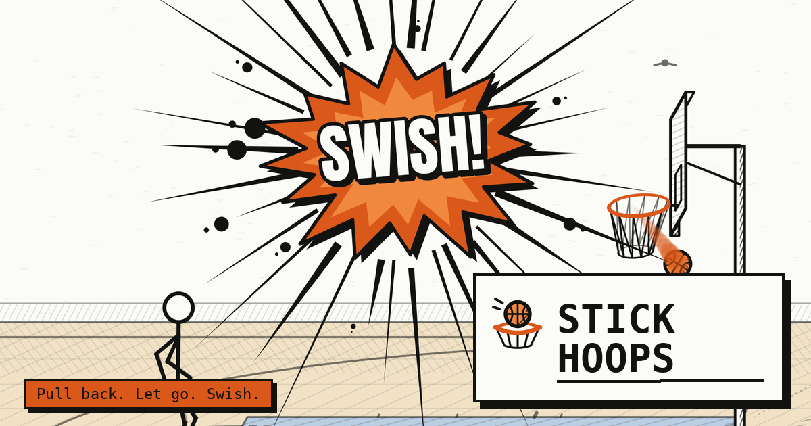

# Stick Hoops

A stick-figure basketball game. Press on the court, pull back like a slingshot, let go.
Six modes, two of them for two players sharing one phone. Free, no sign-up, plays offline.

**Play: [hoops.steekam.me](https://hoops.steekam.me)**



## Run it

```
npm install
npm run dev        # play locally on :5173
npm test           # unit tests
npm run test:e2e   # end-to-end tests on the production build
npm run build      # the deployable site, in dist/
```

## Docs

- [Gameplay](docs/gameplay.md): modes, controls, scoring.
- [Architecture](docs/architecture.md): how the code is laid out, and the rules that keep the physics replayable.
- [Testing](docs/testing.md): what the two suites cover, how the e2e tests aim, and CI.
- [Deploying](docs/deploying.md): Cloudflare Pages, the feedback Worker, caching and offline.
- [Trailer](docs/trailer.md): the release trailer, rendered by the game engine.
- [Contributing](CONTRIBUTING.md)
- [Changelog](CHANGELOG.md)

Made by [steekam](https://steekam.me). MIT licensed.
